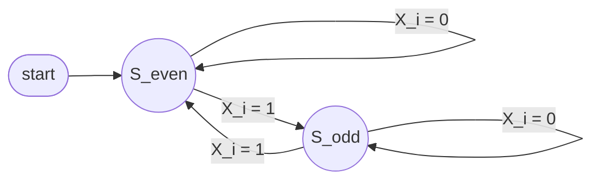

A FSM is an idealised computer which at a given point in time, it is in one of a set of finite set of states. The phrase finite automata $\equiv$ finite state machine.

An alphabet is a non-empty set of symbols

A string $X$ with respect to some alphabet $\sum$ is a sequence of finite length, whose elements are members of $\sum$. For some $n$ such that $X_{i}\in \sum$ for $0\leq i<n$
$$
X = \langle X_{0}, X_{1},\dots X_{n-1} \rangle
$$
A language $\Lambda$ is a set of strings $X$.

C accepts an input string with respect to some $\sum$, one symbol at a time. C either rejects the input string or accepts the input string. 

If $C$ every string in some $\Lambda$. $\Lambda$ is the language of $C$.
# Definition Of a FSM
A (deterministic) Finite State Machine is a tuple
$$
C = (S,s,A,\Sigma,\Gamma, \delta,\omega)
$$
Where $S$ is a finite set of states that include a start state $s\in S$, $A$ is a finite set of accepting states such that $A \subseteq S$, $\Sigma$ is an input alphabet and $\Gamma$ is an output alphabet, $\delta$ is a transition function such that $\delta:S \times \sum \to S$ and an output function $\omega$, such that  $\omega:S \to \Gamma$ (known as a Moore FSM). 

A Moore FSM or:
$$
\omega : S \times \Sigma \to \Gamma
$$
A Mealey FSM has the case of an empty input $\epsilon$, which means a transition can always occur.
# In Theory
Consider the tabular and algorithmic representation of a FSM that decides whether a binary sequences $X$ has an odd number of 1 elements in it. 

$$

\begin{array}{c|cc}
& \delta \\
\hline
 Q  & Q' X_i = 0 & X_i = 1 \\
\hline
S_{\mathrm{even}} & S_{\mathrm{even}} & S_{\mathrm{odd}} \\
S_{\mathrm{odd}} & S_{\mathrm{odd}} & S_{\mathrm{even}}
\end{array}
$$


Double circles around the diagram means that the symbol is in an accepting state, That is $A= \{S_{Odd}\}$

You could implement a FSM like this
$$
\text{arithmetic experssion} 
$$


# Designing an FSM 
1. Replicates the behaviour of a controlled loop counter, e.g., $i$ within a $C$-style loop such as 
2. ```
   f(int i = m; i < n; i++){
   }
   ```
3. Has an interface that allows signalling for
	1. The start of the iteration so $i=m$. The end of the iteration $i=n$.
	